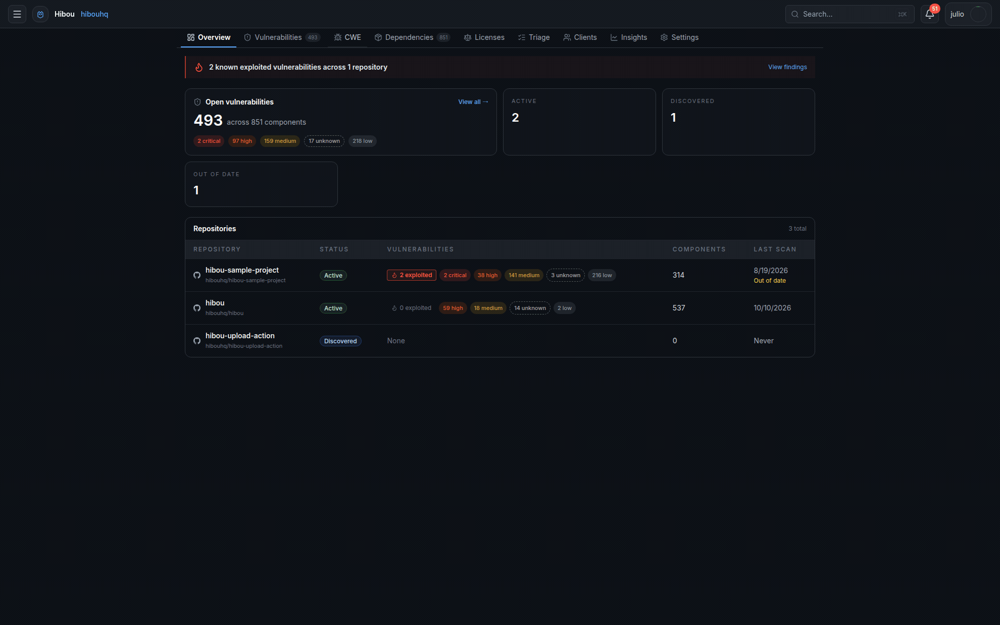
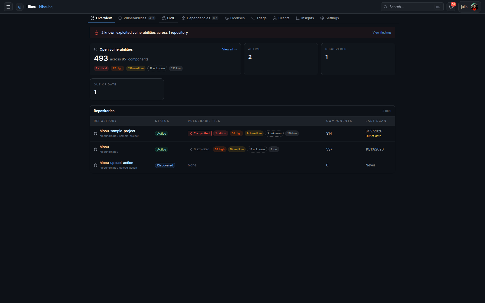
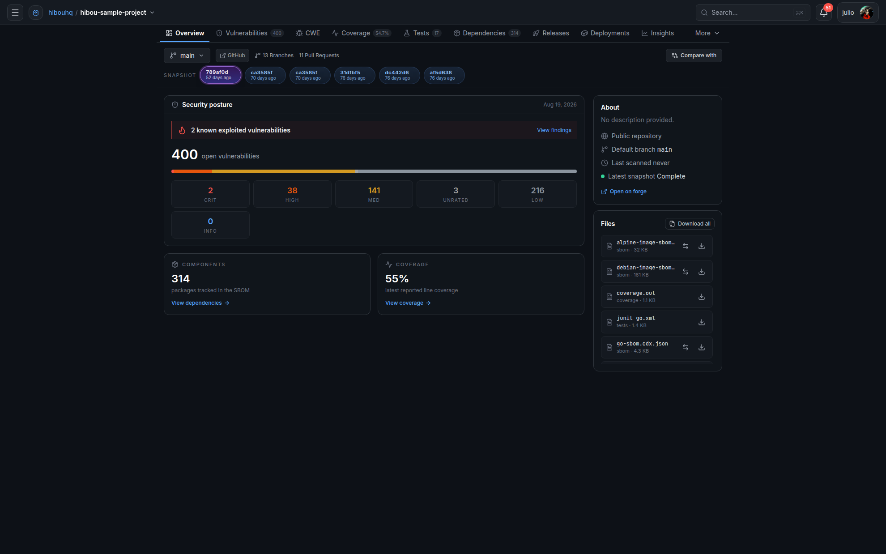
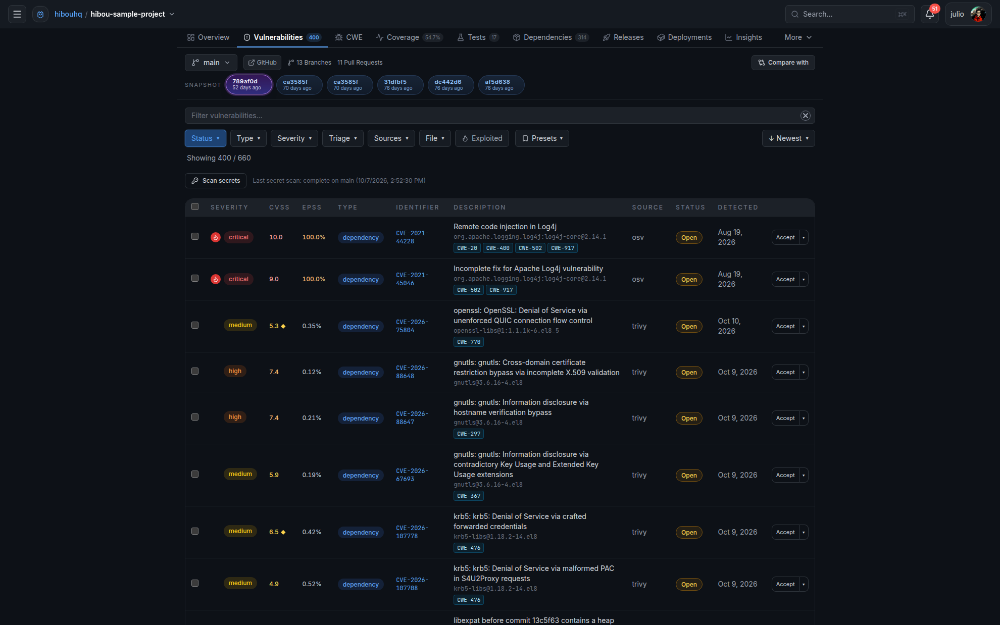
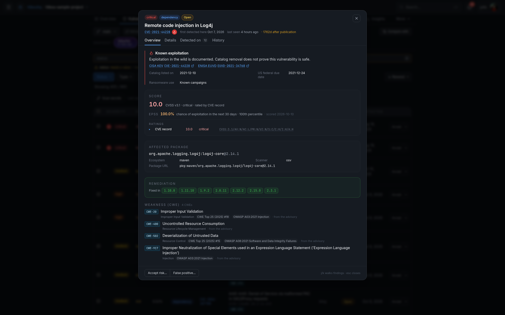
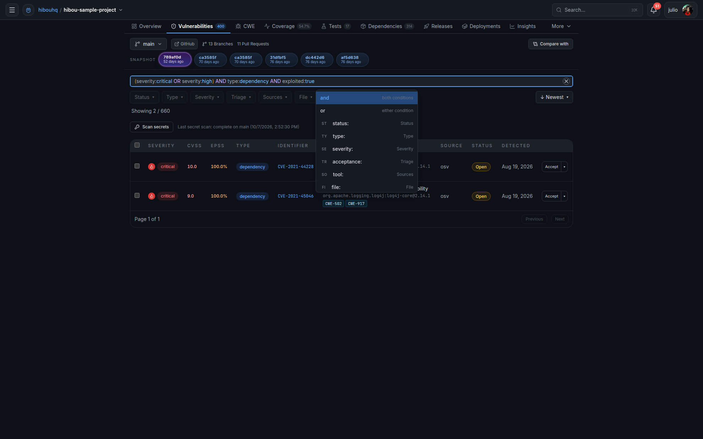
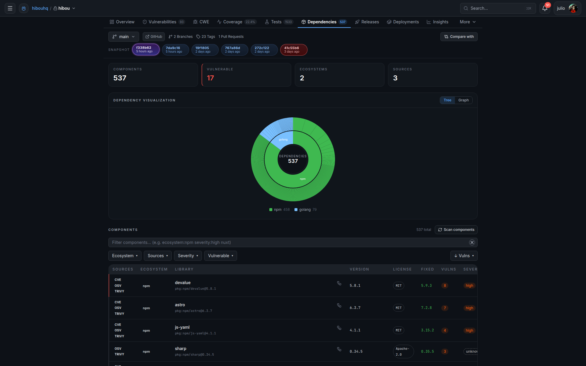
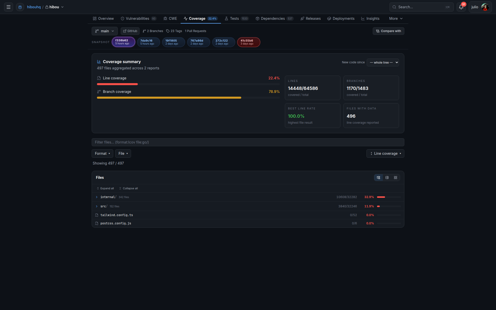
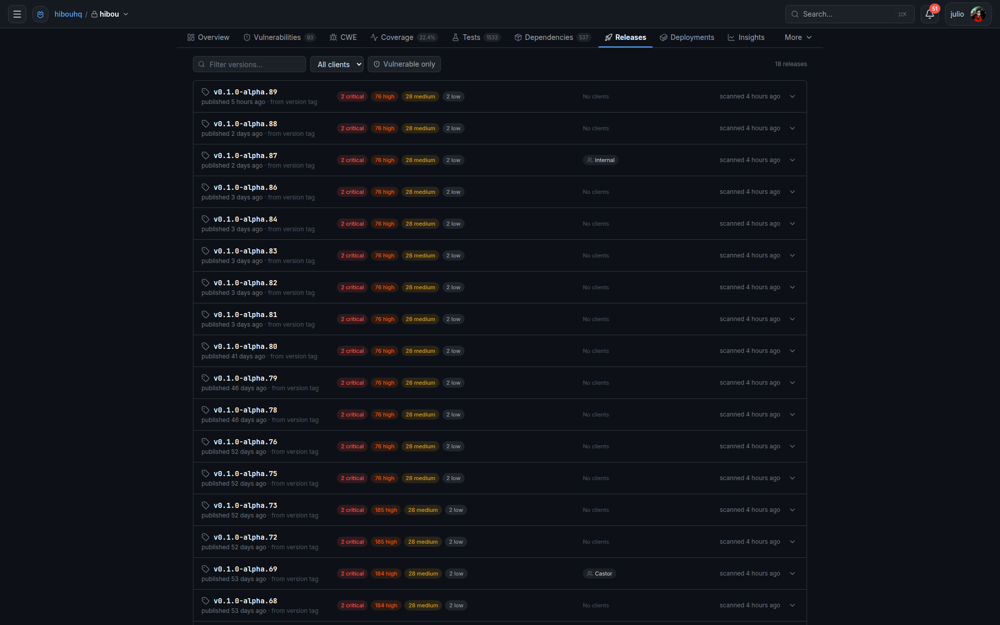

<p align="center"></p>

# Hibou

**Self-hosted, open-source security intelligence for the software lifecycle.** Bring dependency vulnerabilities, code findings, secrets, coverage, and release impact into one workspace on your own infrastructure. Keep your scanners; give their results a shared history and a place to act. Hibou is currently self-hosted only, not a hosted SaaS offering.

[](LICENSE)
[](https://github.com/hibouhq/hibou/releases)
[](#architecture)

[Self-Host](#self-host) · [Documentation](docs/src/content/docs/getting-started/introduction.mdx) · [Releases](https://github.com/hibouhq/hibou/releases) · [Discussions](https://github.com/hibouhq/hibou/discussions) · [Comparison](docs/COMPARISON.md)

[](docs/images/readme/walkthrough.gif)

*A real walkthrough from a self-hosted dogfooding instance: start at the organization, filter findings with a grouped `OR` query, open Log4j detail, switch to Hibou's real SBOM inventory, inspect coverage, and browse releases. Vulnerability examples come from the intentionally vulnerable [sample project](https://github.com/hibouhq/hibou-sample-project); dependency, coverage, and release views come from Hibou itself.*

> [!IMPORTANT]
> **Hibou is in alpha.** This is a solo, spare-time experiment built with LLM assistance, not a production-readiness or support promise. Expect bugs, incomplete workflows, and documentation that can lag behind the code. Feedback and forks are welcome; see the [roadmap](TODO.md).

[Features](#features) · [Capabilities](#capabilities) · [Quick Start](#quick-start) · [Architecture](#architecture) · [Contributing](#contributing)

| Keep your tools | Review what changed | Own your deployment |
| --- | --- | --- |
| Ingest SBOMs, SARIF, secret findings, and coverage from your existing pipeline. | Compare snapshots and pull requests instead of treating every scan as a new inbox. | A Go binary with an embedded Vue UI, PostgreSQL, and Docker or Helm deployment. |

## Features

Every image below comes from a self-hosted dogfooding instance. The sample repository supplies vulnerability examples; Hibou's own scans supply dependency licenses, coverage, and release history. Click an image for the full-size capture.

### Start with the organization

[](docs/images/readme/organization.png)

Scan freshness and risk across repositories share one view. Start at the organization, then move into the repository that needs attention.

### See the repository, not just the scan

[](docs/images/readme/repository.png)

Security posture, known exploited vulnerabilities, dependency inventory, coverage, and uploaded artifacts sit alongside branch and snapshot history. Switch context without losing the repository you are investigating.

| Prioritize findings | Understand the risk |
| --- | --- |
| [](docs/images/readme/findings.png) | [](docs/images/readme/finding-detail.png) |
| **Start with the signal.** Filter by severity, type, source, triage state, or known exploitation. CVSS, EPSS, and scanner provenance help you choose what deserves attention first. | **Go beyond a CVE identifier.** Open a finding to inspect exploitation context, affected package, remediation, and weakness classification. Track triage decisions with VEX rather than losing them between scans. |

### Ask a precise question

[](docs/images/readme/advanced-query.png)

Combine fields with `AND`, `OR`, and parentheses. Autocomplete exposes available filters while you type. For example, prioritize exploited dependency vulnerabilities with high or critical severity:

```text
(severity:critical OR severity:high) AND type:dependency AND exploited:true
```

| Know what you ship | Put coverage in context |
| --- | --- |
| [](docs/images/readme/dependencies.png) | [](docs/images/readme/coverage.png) |
| **An inventory with history.** Import CycloneDX or SPDX SBOMs, inspect components, and compare snapshots as packages are added, upgraded, or removed. Connect dependency risk to the software you actually ship. | **More than a percentage.** Bring Go cover, LCOV, Cobertura, JaCoCo, and Clover reports into the same repository view. Follow file-level coverage and PR deltas, with configurable coverage gates. |

### Review changes before they land

Compare branches, pull requests, and snapshots to see new and resolved findings, dependency changes, and coverage deltas. Forge-native checks bring the result back to GitHub, Forgejo/Gitea, or GitLab.

Quality gates are **advisory by default; blocking is opt-in**. A triage decision can update the PR check without rerunning CI.

### Follow the versions you ship

[](docs/images/readme/releases.png)

Review risk per release and see which clients are associated with each version. Release history connects findings to deployed software instead of leaving them attached only to a branch scan.

## Capabilities

Availability and maturity vary by integration. The [documentation](docs/src/content/docs/getting-started/introduction.mdx) and [roadmap](TODO.md) describe the details and remaining work.

| Area | Included |
| --- | --- |
| **Scan ingestion** | CycloneDX JSON/XML, SPDX JSON, SARIF 2.1.0, secret findings, coverage reports, and test results. |
| **Dependency intelligence** | OSV.dev, NVD, GitHub Advisory, Trivy, and Sonatype OSS Index integration; advisory alias merging; malware signals from OSV and OpenSSF Package Analysis. |
| **Triage and VEX** | OpenVEX, CSAF, and CycloneDX import/export; automatic statements for component upgrades/removals; supplier VEX propagation and re-evaluation. |
| **Reachability** | Go call graphs (RTA/VTA), Java bytecode analysis, and Rust source analysis to help identify unreachable vulnerable code. |
| **Code and secrets** | SARIF from Semgrep, CodeQL, and other producers; Gitleaks, TruffleHog, Betterleaks, and GitHub secret scanning integration. See [SAST scanners](docs/SAST-SCANNERS.md). |
| **Pull requests** | Delta analysis, branch-pattern quality gates, coverage thresholds, forge-native statuses, GitHub Check Runs in App mode, and annotations. |
| **Release impact** | Releases, client deployments, rollback history, and CVE impact analysis across clients. |
| **Organization controls** | Organization/team/repository hierarchy, RBAC, audit logging, ISO 27001 control mapping, and point-in-time compliance reports. |
| **Automation** | REST API, CLI, built-in MCP server, `.hibou.yaml` config-as-code, and onboarding PRs. |
| **Notifications** | Slack, Teams, Discord, HMAC-signed webhooks, and email with organization-level rules; real-time UI updates. |

## Architecture

| Layer | Technology |
|-------|-----------|
| Backend | Go, Chi v5, zerolog, sqlc, golang-migrate |
| Frontend | Vue 3, TypeScript, Pinia, Vue Router, Tailwind CSS |
| Database | PostgreSQL 18 |
| Scanner | Trivy (server mode) |
| Deployment | Helm chart, Docker, single binary |

## Quick Start

### Try it locally

**Prerequisites:** Docker with Compose, Git, Make, Go 1.26.9+, and Node.js 22+. The [VS Code devcontainer](.devcontainer/devcontainer.json) provides the development toolchain.

```bash
git clone https://github.com/hibouhq/hibou.git
cd hibou
cp .env.example .env
go mod download
npm --prefix site install
make dev-local
```

This starts PostgreSQL and Trivy, then the API and Vite frontend. Open **http://localhost:3000** and select **Dev Login**. The API listens on **http://localhost:8585**. Database migrations run automatically when the server starts.

To populate the local instance with example snapshots, findings, coverage, and pull requests, run `make seed` in a second terminal once PostgreSQL is ready.

> [!WARNING]
> Dev Login is for private local development only. Do not expose this instance publicly. Use forge authentication and a production configuration when deploying.

### Self-host

Deploy the embedded UI and Go backend as a single binary or container, backed by PostgreSQL. A [Helm chart](chart/hibou) is included for Kubernetes.

See the [deployment guide](docs/DEPLOYMENT.md), [server configuration example](hibou-server.example.yaml), and [forge authentication guide](docs/src/content/docs/admin/authentication.mdx). Use `make dev` for development with your configured forge provider.

## Make Targets

| Target | Description |
|--------|-------------|
| `make` | Generate, lint, test, and build |
| `make dev` | Run backend + Vite frontend concurrently (hot reload) |
| `make dev-local` | Start local infrastructure and run with Dev Login |
| `make seed` | (Re-)seed the database with sample data |
| `make reset` | Drop the schema and re-seed from scratch |
| `make generate` | Generate sqlc database code and Swagger API docs |
| `make lint` | Run Go and frontend linters + check generated code |
| `make test` | Run Go and frontend tests |
| `make build` | Build frontend then Go binary |
| `make build-all` | Cross-compile for all platforms |

## Project Structure

```text
├── main.go                    # Entry point
├── cmd/                       # Cobra CLI commands
├── internal/
│   ├── api/                   # Response helpers, pagination, validation
│   ├── config/                # Environment-based configuration
│   ├── server/                # HTTP handlers, middleware, routing
│   ├── store/                 # Database layer (sqlc-generated + adapters)
│   │   ├── dbgen/             # Generated code (do not edit)
│   │   ├── queries/           # SQL query definitions
│   │   └── migrations/        # PostgreSQL migrations
│   ├── ui/                    # Embedded SPA assets
│   └── version/               # Build-time version info
├── site/                      # Vue 3 SPA source
├── chart/hibou/               # Helm chart
├── docs/adr/                  # Architecture Decision Records
└── .devcontainer/             # Dev container configuration
```

## Configuration

Configuration is via environment variables with the `HIBOU_` prefix.
See [.env.example](.env.example) for all available options.

| Variable | Default | Description |
|----------|---------|-------------|
| `HIBOU_HOST` | `0.0.0.0` | Server bind address |
| `HIBOU_PORT` | `8585` | Server port |
| `HIBOU_DATABASE_URL` | — | PostgreSQL connection string |
| `HIBOU_LOG_LEVEL` | `info` | Log level (debug, info, warn, error) |
| `HIBOU_LOG_FORMAT` | `console` | Log format (console, json) |
| `HIBOU_TRIVY_URL` | `http://localhost:4954` | Trivy server URL |
| `HIBOU_MCP_ENABLED` | `true` | Enable the built-in MCP server |
| `HIBOU_MCP_PORT` | `8081` | MCP server port |

## Contributing

Feedback from real workflows is especially useful during alpha. Report a bug with the version, scanner/artifact format, reproduction steps, and a screenshot with sensitive data removed. Share ideas in [Discussions](https://github.com/hibouhq/hibou/discussions).

See [CONTRIBUTING.md](CONTRIBUTING.md) for development setup and guidelines, [architecture](docs/ARCHITECTURE.md) for the system design, and [ADRs](docs/adr) for design decisions.

Hibou stands for *HIBOU Is Basically Observant & Unsleeping*.

## License

Hibou is licensed under the GNU Affero General Public License,
version 3 only (AGPL-3.0-only). See [LICENSE](LICENSE) for the full license text.

Third-party components retain their respective licenses.

CI-generated CycloneDX SBOMs explicitly declare `AGPL-3.0-only` for the Hibou
application. Frontend package metadata and the final container image carry the
same declaration; dependency and base-image component licenses remain unchanged.
