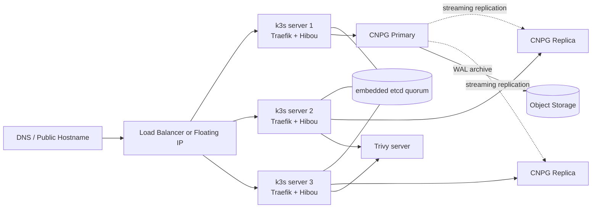

# Hosting Cost Analysis: Hibou on k3s

Prices below use public list pricing commonly quoted in mid-2025 community discussions and provider pricing pages. Expect changes over time, region-specific differences, and VAT differences. USD providers are left in USD to avoid fake precision from exchange-rate conversions.

Community baseline: the EU budget-hosting consensus in [r/kubernetes](https://www.reddit.com/r/kubernetes/comments/1hkwlp2/) still heavily favors Hetzner first, Netcup second, with OVH as a workable budget fallback and DigitalOcean/Vultr mainly used as easier but more expensive comparison points.

Equivalent lightweight Kubernetes distributions such as k0s or MicroK8s do not materially change the infrastructure bill at this size. k3s remains the best default here because it keeps control-plane overhead and operational friction low.

## Pricing Reference Points

- Hetzner Cloud pricing: <https://www.hetzner.com/cloud>
- Netcup VPS pricing: <https://www.netcup.com/en/server/vps>
- OVHcloud VPS pricing: <https://www.ovhcloud.com/en/vps/>
- Scaleway pricing: <https://www.scaleway.com/en/pricing/?tags=compute>
- Contabo VPS pricing: <https://contabo.com/en/vps/>
- IONOS VPS pricing: <https://www.ionos.com/servers/vps>
- Exoscale pricing: <https://www.exoscale.com/pricing/>
- Oracle Cloud Free Tier: <https://www.oracle.com/cloud/free/>
- Vultr Cloud Compute pricing: <https://www.vultr.com/pricing/#cloud-compute>
- DigitalOcean Droplet pricing: <https://www.digitalocean.com/pricing/droplets>

## Executive Summary

For a paid deployment, the cheapest sane default is a single Hetzner CAX11 running k3s, PostgreSQL, and Trivy on one ARM node. That lands around EUR 5 to EUR 6 per month after adding a low-cost domain and basic backups, while still leaving enough headroom for Hibou's documented requests and normal burst behavior.

For a multi-node setup, the cheapest paid option is three Hetzner CAX11 nodes at EUR 11.37 per month in raw node cost. In practice, real HA usually needs an external entrypoint strategy such as a load balancer or floating-IP design, so the more honest budget is roughly EUR 16 to EUR 18 per month before off-site backups.

Oracle Cloud Free Tier is the absolute cheapest path at EUR 0, and it can run Hibou comfortably on ARM, but it is not the default recommendation. Account churn risk, capacity availability, weaker support, and free-tier uncertainty make it a hobby or lab choice, not the most predictable home for an internal security tool.

Other major cloud providers (GCP, AWS, Azure) offer free tiers, but all cap at 1 GiB RAM - too small for k3s plus PostgreSQL plus Trivy. Oracle remains the only viable free option.

## Application Resource Requirements

The numbers below come from the current Hibou chart values and orchestrator sizing notes.

| Component | CPU Request | CPU Limit | RAM Request | RAM Limit | Storage |
| --- | ---: | ---: | ---: | ---: | ---: |
| Hibou server | 100m | 500m | 128Mi | 512Mi | - |
| PostgreSQL 18 | 250m | 1 CPU | 256Mi | 1Gi | 10Gi |
| Trivy server | 100m | 500m | 256Mi | 512Mi | - |
| CNPG operator | 100m | 200m | 128Mi | 256Mi | - |
| Application subtotal | 550m | 2.2 CPU | 768Mi | 2.25Gi | 10Gi+ |
| k3s overhead | 300m | n/a | 512Mi | n/a | small |
| Real minimum node target | 850m | n/a | ~1.3Gi | n/a | 20Gi+ |

### Practical Sizing Interpretation

- A 2 GiB node is the floor, not the comfort target.
- A 4 GiB node is the best low-cost shape because it leaves room for kernel cache, PostgreSQL spikes, image pulls, and upgrades.
- 1 vCPU plans are possible only if workload is tiny and scans are infrequent; they are not a good default.
- CNPG operator adds modest overhead (~100m CPU, ~128Mi RAM) but enables declarative PostgreSQL management, automated failover, and continuous backup to object storage. On multi-node HA clusters with 2-3 PG replicas, total PostgreSQL resource usage scales accordingly.
- ARM is viable because Hibou, PostgreSQL, Traefik, and Trivy all support arm64 in normal deployments. Verify any extra sidecars or custom scanner images before committing to ARM everywhere.

## Scenario A: Single-Node k3s

### Why Single-Node Works

- Hibou is typically an internal security platform, not a public SaaS with strict uptime commitments.
- k3s keeps control-plane overhead low and uses SQLite on a single server, which avoids etcd complexity.
- The app shape is compact: one Go binary, one CNPG-managed PostgreSQL instance, one Trivy server, one ingress.
- Backup is handled by CNPG: continuous WAL archiving to object storage plus scheduled base backups, with point-in-time recovery built in.
- Operational complexity stays low enough for one small team to own without dedicated platform staff.

### Provider Comparison Table

| Provider | Plan | vCPU | RAM | Disk | Traffic | Monthly Cost | Verdict | Notes |
| --- | --- | ---: | ---: | ---: | --- | ---: | --- | --- |
| Oracle Cloud | Always Free Ampere A1 | up to 4 ARM cores total | up to 24 GiB total | boot volume quotas apply | egress limits apply | EUR 0 | Lab winner | Cheapest possible, but operationally less predictable |
| Scaleway | Stardust1-S | 1 vCPU | 1 GiB | 10 GB local | 100 Mbit/s unmetered | EUR 1.80 | Too small | Cannot fit k3s plus PostgreSQL in 1 GiB |
| IONOS | VPS Linux S | 1 vCPU | 2 GiB | 80 GB SSD | unlimited | EUR 2.00 | Too tight | Same RAM problem as OVH Starter |
| OVHcloud | Starter VPS | 1 vCPU | 2 GiB | 20 GB | limited budget VPS tier | EUR 3.50 | Too tight | Can boot, but leaves little room for k3s plus PostgreSQL |
| Hetzner Cloud | CAX11 | 2 ARM | 4 GiB | 40 GB | 20 TB | EUR 3.79 | Best paid choice | Cheapest paid plan that still feels comfortable |
| Scaleway | DEV1-S | 2 vCPU | 2 GiB | 20 GB local | 200 Mbit/s | EUR 4.34 | Tight | 2 GiB is the floor, not comfortable |
| Hetzner Cloud | CX22 | 2 shared x86 | 4 GiB | 40 GB | 20 TB | EUR 4.35 | Best x86 fallback | Slightly more expensive, removes ARM concern |
| Netcup | VPS 1000 G11 | 4 vCPU | 4 GiB | 128 GB SSD | generous, fixed-price VPS | EUR 4.98 | Strong alternative | More disk than needed, less polished cloud UX |
| IONOS | VPS Linux M | 2 vCPU | 4 GiB | 160 GB SSD | unlimited | EUR 5.00 | Viable | Good disk, unlimited traffic, decent budget pick |
| Contabo | VPS S SSD | 4 vCPU | 8 GiB | 200 GB SSD | 32 TB | EUR 5.99 | Best specs per euro | Absurd on paper; community reports weaker single-thread perf and occasional overselling. Worth testing. |
| OVHcloud | Essential VPS | 2 vCPU | 4 GiB | 80 GB | budget VPS | EUR 6.00 | Viable | Fine technically, weaker on pure price |
| Vultr | Cloud Compute | 1 vCPU | 1 GiB | small | limited | USD 6 | Not viable | Too little RAM for k3s plus PostgreSQL |
| DigitalOcean | Basic Droplet | 1 vCPU | 1 GiB | small | limited | USD 6 | Not viable | RAM too small |
| Scaleway | DEV1-M | 3 vCPU | 4 GiB | 40 GB local | 300 Mbit/s | EUR 8.68 | Viable but expensive | Fine technically, nearly 2x the Hetzner CAX11 price |
| Vultr | Cloud Compute | 1 vCPU | 2 GiB | small | limited | USD 12 | Barely viable | Higher cost than EU budget providers |
| DigitalOcean | Basic Droplet | 2 vCPU | 2 GiB | small | limited | USD 12 | Viable but poor value | Easy UX, weak budget efficiency |
| Exoscale | Standard Small | 2 vCPU | 2 GiB | 50 GB | pay per use | about EUR 14 | Too expensive | Swiss quality, Swiss pricing. Not budget category |

### Recommended: Hetzner CAX11

Hetzner CAX11 is the best paid answer because it clears Hibou's real minimum sizing while staying below every mainstream x86 alternative. Two ARM cores and 4 GiB RAM are enough for k3s, PostgreSQL, Traefik, Trivy, and the Hibou server with modest growth room. The included 40 GB disk is also enough for the app, PostgreSQL data, images, and logs if scans are not retaining large artifacts forever.

Why this beats the alternatives:

- Cheaper than Hetzner CX22 while keeping the same RAM footprint.
- Cheaper than Netcup VPS 1000 G11, unless extra disk is more important than lower price.
- Much cheaper than DigitalOcean or Vultr for equivalent usable memory.
- Easier and more predictable than Oracle Free Tier if this is a real internal service instead of a lab box.

When to choose CX22 instead:

- You need x86 immediately and do not want to validate arm64 image coverage.
- You rely on vendor tooling or binaries that are still x86-first.
- You want the lowest-friction migration path from typical developer laptops and CI images.

### Total Monthly Cost Breakdown

#### Recommended paid baseline: Hetzner CAX11

- VPS: EUR 3.79
- Object storage for CNPG WAL archive + base backups: about EUR 1 to EUR 2
- Domain amortization: about EUR 1.00
- Estimated total: about EUR 5.8 to EUR 6.8 per month

#### Slightly safer x86 baseline: Hetzner CX22

- VPS: EUR 4.35
- Object storage for CNPG WAL archive + base backups: about EUR 1 to EUR 2
- Domain amortization: about EUR 1.00
- Estimated total: about EUR 6.4 to EUR 7.4 per month

#### Absolute cheapest experimental path: Oracle Free Tier

- Compute: EUR 0
- Domain amortization: about EUR 1.00
- Optional off-site backup storage: EUR 0 to low single digits
- Estimated total: about EUR 1 to EUR 3 per month

### Single-Node Recommendation

If your goal is cheapest viable self-hosting, use one Hetzner CAX11 and stop there. This is the price-performance winner for a small internal Hibou deployment. Only skip it if ARM is a blocker or if you already have free Oracle capacity and accept the free-tier risk profile.

## Scenario B: Multi-Node k3s Cluster (3 nodes for HA)

### When You Need This

- You need node-failure tolerance for the Hibou API and ingress path.
- You want rolling upgrades without taking the service fully offline.
- You have internal uptime expectations high enough that a single VPS is too fragile.
- You want to separate system risk from application risk, even if Hibou is still an internal tool.

### Architecture

For actual control-plane HA, use three k3s server nodes with embedded etcd. A "1 server + 2 agents" layout is cheaper in complexity, but it is not control-plane HA because losing the single server loses cluster management. For a real HA story, three server nodes are the right answer.

PostgreSQL HA is handled by the CNPG operator. A CNPG `Cluster` with 2 or 3 instances provides streaming replication, automatic failover, and fencing — all managed declaratively. On a 3-node k3s cluster, pod anti-affinity spreads PG replicas across nodes so a single node failure does not lose the database. CNPG also handles continuous WAL archiving to object storage, giving point-in-time recovery without manual `pg_dump` scripts.

### Provider Comparison Table

| Provider | Plan (x3) | Total vCPU | Total RAM | Monthly Cost | Notes |
| --- | --- | ---: | ---: | ---: | --- |
| Oracle Cloud | Free-tier ARM split across instances | up to 4 ARM cores total | up to 24 GiB total | EUR 0 | Possible for experiments, not a serious HA recommendation |
| Hetzner Cloud | 3 x CAX11 | 6 ARM | 12 GiB | EUR 11.37 | Cheapest paid HA node pool |
| Hetzner Cloud | 3 x CX22 | 6 shared x86 | 12 GiB | EUR 13.05 | Best x86 HA baseline |
| Netcup | 3 x VPS 1000 G11 | 12 vCPU | 12 GiB | EUR 14.94 | More compute and disk, still cheap |
| IONOS | 3 x VPS Linux M | 6 vCPU | 12 GiB | EUR 15.00 | Solid budget alternative to Hetzner |
| Contabo | 3 x VPS S SSD | 12 vCPU | 24 GiB | EUR 17.97 | Most raw resources per euro, test before trusting |
| OVHcloud | 3 x Essential VPS | 6 vCPU | 12 GiB | EUR 18.00 | Technically fine, weaker value |
| Scaleway | 3 x DEV1-M | 9 vCPU | 12 GiB | EUR 26.04 | Viable but poor value vs Hetzner |
| DigitalOcean | 3 x USD 12 droplets | 6 vCPU | 6 GiB | USD 36 | Simple, but expensive for this use case |
| Vultr | 3 x USD 12 instances | 3 vCPU | 6 GiB | USD 36 | More expensive and thinner on CPU |

### Recommended Setup

The cheapest paid cluster is three Hetzner CAX11 nodes. Raw node cost is EUR 11.37 per month, which is absurdly low for a real three-server k3s control plane. It works because Hibou's footprint is small and k3s keeps the control plane light.

Recommended layout:

- 3 x Hetzner CAX11 (or CAX21 if running 3 PG replicas and want more headroom) as k3s server nodes
- Traefik as the built-in ingress
- Hibou deployment with 2 or 3 replicas spread across nodes
- CNPG PostgreSQL cluster with 2-3 instances, anti-affinity across nodes
- Continuous WAL backup to Hetzner Object Storage (or any S3-compatible target)
- Trivy server on-cluster with one replica, or tolerate restart during node maintenance

This layout provides full HA: application, control-plane, and database. CNPG handles PostgreSQL failover automatically — losing one node promotes a replica to primary without manual intervention.

Important caveat: raw node cost is not the whole HA bill. If you need clean external failover for the webhook endpoint and UI, add either:

- A provider load balancer, if available and priced reasonably
- A floating-IP or failover-IP design
- DNS failover, which is cheaper but slower and weaker than a proper load balancer

That means the realistic cheapest HA bill is usually node cost plus one shared entrypoint service.

### vs Managed Kubernetes

Managed Kubernetes stops being cost-efficient quickly at this scale.

- DigitalOcean Kubernetes: free control plane, plus nodes. With three USD 12 droplets, total is about USD 36 per month.
- Linode LKE: free control plane, but realistic worker cost is still around USD 36 per month for three small nodes.
- Civo: about USD 5 per month for the cluster, plus node costs.

For Hibou, managed Kubernetes only makes sense if you strongly value provider-managed control planes over raw cost. The app itself is small enough that k3s on cheap VPS nodes wins easily.

### Total Monthly Cost Breakdown

#### Lowest raw node cost: 3 x Hetzner CAX11

- Nodes: EUR 11.37
- Basic backup budget: about EUR 2.27
- Domain amortization: about EUR 1.00
- Raw total without external HA entrypoint: about EUR 14.64 per month

#### More realistic full HA total (including database)

- Nodes: EUR 11.37
- Basic backup budget: about EUR 2.27
- Domain amortization: about EUR 1.00
- Object storage for CNPG WAL archive: about EUR 1 to EUR 2 (Hetzner: EUR 0.0065/GB/mo)
- Load balancer or equivalent failover entrypoint: usually low single digits to about EUR 5
- Estimated realistic total: about EUR 16 to EUR 20 per month

### Multi-Node Recommendation

If you truly need HA, buy three Hetzner CAX11 nodes. CNPG handles database HA declaratively with minimal operational overhead. The node economics are so strong that the main remaining cost question is the ingress entrypoint strategy, since CNPG covers database HA at no extra compute cost beyond the replica instances already running on the same nodes.

## Cost Comparison Summary

| Scenario | Cheapest Option | Monthly | Annual |
| --- | --- | ---: | ---: |
| Single-node, absolute cheapest | Oracle Cloud Free Tier | EUR 0 to low single digits | EUR 0 to low double digits |
| Single-node, recommended paid | Hetzner CAX11 | about EUR 6 to EUR 7 | about EUR 72 to EUR 84 |
| Single-node, EU budget alternative | Contabo VPS S or IONOS VPS M | EUR 5 to EUR 6 | EUR 60 to EUR 72 |
| Multi-node HA, lowest raw node cost | 3 x Hetzner CAX11 | EUR 11.37 | EUR 136.44 |
| Multi-node HA, realistic total | 3 x Hetzner CAX11 plus CNPG backups, domain, entrypoint | about EUR 16 to EUR 20 | about EUR 192 to EUR 240 |

## Free Tier Landscape

### Provider Free Tier Comparison

| Provider | Free Tier Offer | vCPU | RAM | Duration | Viable for k3s + Hibou? |
| --- | --- | ---: | ---: | --- | --- |
| Oracle Cloud | Always Free Ampere A1 | up to 4 ARM cores | up to 24 GiB | Forever | Yes - the only viable free option |
| Google Cloud | e2-micro | 0.25 shared vCPU | 1 GiB | Forever (us-* regions only) | No - far too small for k3s + PostgreSQL + Trivy |
| AWS | t3.micro / t4g.micro | 1-2 vCPU (burstable) | 1 GiB | 12 months only | No - too small and expires |
| Azure | B1s | 1 vCPU | 1 GiB | 12 months (750 h/mo) | No - too small and expires |
| IBM Cloud | Free VPC instance | 2 vCPU | 4 GiB | Limited (subject to change) | Marginal - specs look fine but IBM free tier terms shift frequently and availability is inconsistent |
| Fly.io | 3 shared-cpu-1x machines | 1 shared each | 256 MiB each | Forever | No - 256 MiB per machine is unusable for this stack |

### Why Only Oracle Works

The hyperscaler free tiers (GCP, AWS, Azure) all cap at 1 GiB RAM. Hibou's application subtotal alone requests 768 MiB, and k3s needs another 512 MiB for its control plane. A 1 GiB machine cannot run this stack - it will OOM before PostgreSQL finishes initializing.

Oracle's free ARM offer is in a different league: up to 4 cores and 24 GiB of RAM is enough to run Hibou, PostgreSQL, Trivy, k3s, and still have substantial headroom. No other provider's always-free tier comes close.

### Oracle Cloud Free Tier: Caveats

Oracle's free ARM capacity is good enough to run Hibou comfortably, and on paper it is unbeatable. In practice, it comes with tradeoffs:

- Free-tier capacity can be unavailable in some regions - instance creation may fail repeatedly until capacity opens up.
- Accounts can be more brittle than paid VPS providers - reports of unexpected reclamation or account restrictions exist in the community.
- Support expectations are minimal on free accounts.
- Free-tier infrastructure is a weak place to anchor an internal security workflow if the tool becomes important to day-to-day operations.
- HA is mostly theoretical because free instances do not remove provider-level risk, and external failover options stay limited.

Use Oracle Free Tier when the goal is learning, testing, demos, or a non-critical team tool. Do not treat it as the default home for a system other teams depend on.

## Operational Considerations

### Backups

- CNPG provides continuous WAL archiving to S3-compatible object storage (Hetzner Object Storage, MinIO, Backblaze B2, etc.).
- Scheduled base backups complement WAL archiving for faster recovery of large databases.
- Point-in-time recovery (PITR) is built in — recover to any moment, not just the last dump.
- On single-node setups, CNPG backup to external object storage is your disaster recovery lifeline.
- On multi-node setups, CNPG backup plus streaming replicas give both local HA and off-site DR.
- Test restore quarterly; automated backup that never restores is still fake savings.

### Monitoring

- Uptime Kuma on the same node is enough for basic endpoint checks.
- Node Exporter plus Prometheus is possible, but often overkill on the smallest deployments.
- Keep logs local first; add remote aggregation only if you are actually reading it.

### Updates and Upgrades

- Single-node: patch during a maintenance window and accept a short outage.
- Multi-node: roll k3s one server at a time, then roll the Hibou deployment.
- Keep PostgreSQL upgrades conservative; database downtime is more disruptive than app restarts here.

### Security Hardening Basics

- Use SSH keys only. Disable password auth.
- Keep public exposure limited to the ingress path and SSH from trusted sources.
- Use TLS with Let's Encrypt through Traefik or cert-manager.
- Keep Hibou webhook protections enabled: signature validation, GitHub IP allowlisting, and rate limiting.
- Store backups off-node so a compromised server does not take the only backup with it.

## Recommendation

For a small team running Hibou as an internal security tool, the best default is one Hetzner CAX11 with k3s. It is cheap enough to be almost disposable, large enough to run the full stack comfortably, and simple enough that one engineer can manage it without building a platform team.

Move to three-node k3s only when you have a real availability requirement, not because Kubernetes culture says HA is always better. At Hibou's size, the cheapest viable answer is usually the correct answer: single-node first, Hetzner CAX11 first, paid Oracle alternative only for experiments, and three-node HA only after downtime costs more than the extra EUR 10 to EUR 15 per month.
