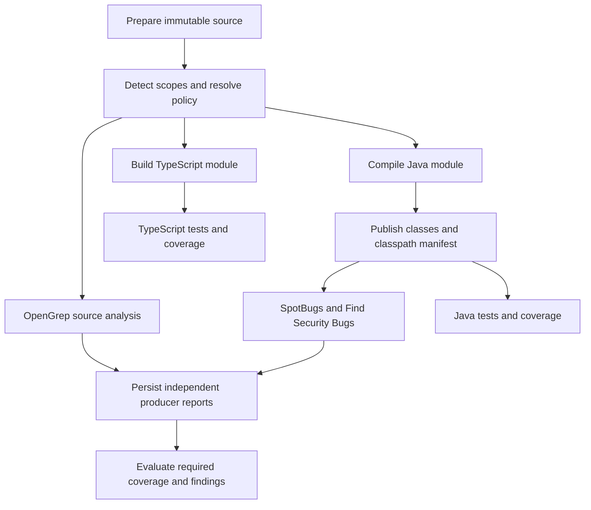

# ADR-035: Bundled scanners, dependency-aware execution, and coverage policy

## Status

Accepted (2026-10-10). The CI-first scope is implemented: catalog, distribution
policy and offline bundles, applicability detection, scan plans, `hibou scan`,
repo settings, org requirements and exceptions, the coverage inventory and the
PR coverage check. See [the implementation plan](034-036-implementation-plan.md)
for what landed and what is still open (ruleset licence review, bulk
enablement, managed runners).

The Java POC was measured on 2026-10-10: released OpenGrep 1.30.1 has no
interfile taint and misses the cross-file flow; the upstream
`v2.0.0-nopython-interfile` pre-release finds it (with `--dataflow-traces` for
the code flow); SpotBugs + Find Security Bugs 4.9.3 + 1.13.0 find it in
bytecode.

[ADR-036](036-automatic-scan-planning-and-verification.md) specifies automatic
scope discovery, scan modes, and flow-aware finding verification.

## Context

Hibou ingests scanner reports but repository owners must currently assemble most
scanners themselves. We want easy, consistent coverage without requiring every
repository to maintain its own scanner installation and upgrade workflow.

[SAST-SCANNERS.md](../SAST-SCANNERS.md) documents candidates and report quirks.
OpenGrep covers many source languages; SpotBugs + Find Security Bugs covers JVM
bytecode. These overlap on Java but provide different analysis. Neither language
support nor scanner enablement proves that a repository was adequately scanned.

Take inspiration from GitLab's analyzer catalog, repository detection, reusable
CI integration, and centralized policy. Do not copy an execution model that
starts all selected analyzers together regardless of build dependencies or
resource pressure. Cross-file taint is a candidate capability, not evidence of
equivalent detection quality. General correctness and maintainability also need
their own rules and evaluation, beyond security SAST.

## Decision

### 1. Bundle integrations; let adapters choose CI distribution

Keep the default Hibou server/CLI image small. Do not embed OpenGrep, a JVM,
Maven, and every other scanner in it. The single-binary control plane remains
unchanged ([ADR-001](001-single-binary-embedded-spa.md)). Built-in secret scanning
continues under its existing model ([ADR-010](010-secret-scanning.md)).

CI must obtain each selected scanner, but a container image is not mandatory.
Default to the simplest verified distribution compatible with the existing CI
runtime: a pinned standalone binary for tools such as OpenGrep, or pinned Maven
plugin coordinates/JARs for JVM analysis in a job that already has the JDK.
Retrieve through maintained setup adapters, verify immutable checksums and
signatures/provenance when available, and reuse a verified versioned CI cache.
Lock the transitive runtime/plugin dependencies as well as the top-level version.
No mutable install script piped to a shell or floating release lookup per run.

Optional analyzer images are useful for complex runtime stacks, consistent
container environments, or operator-managed runners. Pulling an image still
fetches the scanner and runtime in CI; it can cost more transfer/startup than a
binary but avoids rebuilding the environment. Choose per adapter and runner,
not a mandatory source/JVM image pair. Published images are independently
versioned and digest-pinned; no mandatory all-scanner image. Isolation still
requires runner security controls, not merely an image.

Bundled means Hibou supplies supported adapters, maintained setup integrations,
locked distributions, and execution/report contracts, not scanner executables in
the server or a requirement for every repo to use container jobs.

#### Offline distribution and location overrides

Setup configuration supports an operator-controlled catalog/release base URL,
per-scanner binary release location, package repository/mirror, optional OCI
registry, and local verified bundle/cache directory. Precedence is an approved
per-scanner location, then installation-wide mirror, then upstream defaults.
Org/repo choices may select only operator-approved locations; arbitrary PR URLs
must not redirect executable downloads or inject package sources.

A mirror changes transport/location, not the locked version, artifact digest,
ruleset or trusted signing identity. Custom builds require a separately approved
catalog entry and provenance. Support internal CA trust and scoped mirror
credentials; never place credentials in logged URLs. Validate transports, path
resolution and approved hosts before acquisition. Configuration labels here are
proposed contracts, not existing config keys.

Support three modes: upstream-enabled, mirror-only, and offline. Mirror-only has
no public fallback. Offline performs no network requests, including version
lookups, telemetry, rule fetches, signature transparency-log calls or vulnerability
database updates; verify with bundled verification material and declared policy.
Missing artifacts fail setup explicitly and report required artifact IDs.
Unverifiable artifacts fail integrity checks; neither case silently skips an
enforced scanner or downloads from upstream.

Provide a connected preparation/export step producing a versioned manifest and
transfer bundle containing selected binaries/packages, runtime prerequisites,
rules, transitive dependencies, licenses, SBOMs, verification material and,
where needed, advisory databases with refresh timestamps. Import verifies the
manifest and contents before promoting them into a read-only artifact store.
Internal mirrors use the same manifest. Required runners/architectures must all
be represented; a binary for another platform is not usable cached coverage.

For Maven, mirror and prefetch plugins, their transitive dependencies, toolchains,
and project compile dependencies; a cached Find Security Bugs JAR alone is not
an offline build. Apply equivalent dependency closure for other package managers.
Offline runs explicitly use their offline mode. Rule/database staleness is shown
against org freshness policy, not hidden by successful scanner startup. Cache
hits are digest-verified and scoped against untrusted job cache poisoning.

CI execution is the first delivery mode. A reusable integration resolves the
effective policy and creates a scan plan; repo CI provides source and build
artifacts. Existing externally produced SARIF remains supported. An equivalent
external producer can satisfy coverage only when its identity, scope, versions,
rules, and successful execution meet policy; arbitrary tool-name strings alone
must not be sufficient evidence for enforced policies.

Later, operator-enabled isolated runners may consume durable scan jobs using
[ADR-015](015-stateless-processing-and-worker-scaling.md) leases and idempotency.
The API and artifact-ingestion workers never execute arbitrary repository builds
in their own process or pod. Server-managed execution is not required for initial
repo enablement and must not create a second policy model.

### 2. Catalog capabilities separately from languages

One scanner can support many languages; one language can benefit from several
scanners. Store supported combinations rather than a single language field.

Each versioned catalog entry declares:

- Stable scanner ID, engine and adapter versions, distribution kind, binary or
  package checksums (or optional image digest), architectures and runtime contract.
- Ruleset ID, immutable revision/digest, redistribution license and support status.
- Language/capability pairs, e.g. Java/source-patterns, Java/cross-file-taint,
  Java/bytecode-security, Kotlin/bytecode-security. Do not infer that every
  supported language gets every advertised capability.
- Applicability predicates: source extensions, manifests, build systems, runtime
  requirements, compiled artifact formats, and relevant repository path scope.
- Prerequisite stages, inputs/outputs, full/diff behavior, resource estimates,
  timeouts, exit-code meanings, suppression and trace support, SARIF adapter.

Cross-file OpenGrep support is not advertised for the released 1.30.x
distribution: the measured binary lacks it. It ships in the separate
`v2.0.0-nopython-interfile` pre-release line, catalogued as a preview entry that
an org must opt into by name. That build reports `semanticVersion` 1.30.0, so a
version string cannot identify it: catalog entries are pinned and recognized by
sha256. Each capability records its evidence: `measured:<fixture run>` or
`declared` by the engine.
Rules licensing is checked separately from engine licensing. Initial candidates
are OpenGrep and SpotBugs + Find Security Bugs; PMD Java correctness rules are a
separate possible capability, not bundled by assumption. Existing dependency,
secret, and IaC coverage participate in inventory without pretending they are SAST.

### 3. Detect applicability by repository scope and commit

Inspect tracked paths and manifests at the requested commit, using forge language
metadata as a hint rather than authoritative proof. Identify monorepo modules and
exclude generated, vendored, build-output, and dependency directories according
to recorded configuration. Detection is cheap and does not run repository code.

Record observed languages, manifests, module paths, detection revision, source
commit and exclusions. A multilingual repo can enable OpenGrep once while its
plan contains separate applicable scopes. JVM bytecode scanning targets modules
with compatible compiled artifacts, not every file marked Java or Kotlin.

A verified Markdown-only repo has no source SAST requirement. A docs repo with
JavaScript, a Dockerfile, Terraform, or code-bearing build scripts can still have
applicable analysis. Secret detection may remain applicable to text-only repos.
An inaccessible repo, stale manifest, unsupported language, or empty upload is
not proof of non-applicability: show unknown or unsupported coverage instead.

Owners can refine detection/exclusions, with audit history. An exclusion that
removes required scope needs an org-approved exception; declaring code to be
documentation must not bypass policy. Language changes invalidate the plan and
reevaluate inherited defaults on subsequent commits.

### 4. Schedule a dependency graph, not a simultaneous scanner fan-out

The planner emits jobs with explicit dependencies and bounded resource requests.
Source-only scanners start after source preparation and can overlap compilation.
Bytecode scanners start when their module's compile artifact and dependency
classpath are available; they need not wait for test, coverage, packaging, or an
unrelated language build to finish. Some Java analyzers are source-only, so
"Java requires compile" is not a global scheduling rule.

Example for a mixed Java/TypeScript repository:

This is a logical graph, not a requirement for separate upload/download jobs at
every arrow. For small Maven projects, compile and bytecode analysis can share
one CI job and avoid artifact transfer; source analysis runs in another job.
Allow this execution grouping without removing dependency or producer boundaries.

Reuse existing compilation whenever possible: do not compile again solely to
scan. Artifacts declare repo/commit/module, compiler/JDK, target bytecode level,
dependency classpath, build configuration digest, and content hashes. The adapter
rejects stale commits and incompatible bytecode. Missing classes or dependency
artifacts are prerequisite failures, not zero-finding passes. Framework-generated
code and multi-module classpaths must be accounted for. A build failure blocks
dependent scans while independent source scans continue.

Default scheduling is bounded, work-conserving concurrency with explicit
CPU/memory/scratch budgets and per-org quotas. Do not start every analyzer at
once, multiply each engine's internal parallelism by unbounded job concurrency,
or serialize unrelated modules behind a global compile barrier. Expose scanner
thread limits, job concurrency, priority, timeout, and a serial low-resource
preset. Reject plans whose required runtime cannot be provisioned.

Record preparation/build/queue/scan/report durations and cache usage so critical
paths are inspectable. Source trees are immutable scan inputs. Builds run in
separate writable workspaces; concurrent jobs never mutate the same target tree.
Cache keys include commit or source hashes, toolchain, dependencies and config;
scan-result caches also include engine and ruleset digests. Caches are optional,
scoped to tenant/trust boundary, and never substitute for verified run metadata.

PR scans may use diff mode only where producer semantics justify it. Cross-file
analysis keeps the required project context; deleting unchanged files to make
analysis faster is not a valid optimization. Schedule full default-branch scans
and disclose partial scopes per [ADR-034](034-absence-is-not-resolution.md).

### 5. Repository enablement and org enforcement

Repo settings expose one enable toggle per applicable scanner, with explicit
scope and preset selectors. Initial modes are inherit, enabled, and disabled.
Org defaults recommend capabilities based on applicability, not a static list
that demands OpenGrep in every documentation repository.

Org admins may additionally require capability/language/scope combinations,
approved providers and version floors, allowed execution modes, full-scan cadence,
and freshness. A Java security requirement can need both source taint and
bytecode analysis; a Kotlin module need not qualify for Java-specific source
rules. Coverage requirements must name measurable rule/capability contracts,
not assume any one scanner covers all weaknesses.

Resolution order: operator availability constrains execution; org mandatory
requirements constrain repo choices; repo choices replace inherited recommendations
only; otherwise org defaults apply. Stricter org requirements are not loosened by
repo config or a PR editing that config. Unlike the license policy in
[ADR-030](030-org-license-policy-and-repo-override.md), these scanner requirements
are explicitly enforceable. Repo maintainers may add coverage but need an
approved, reasoned, scoped, expiring exception to remove required coverage.

Evaluate enforced policy from trusted org state only: repository settings,
requirements and exceptions are database state edited through the API and UI,
and no branch configuration is read for them, so no PR change can affect them. Snapshot effective policy and applicability with each
plan. Enabling a scanner queues or provisions a run, not an immediate compliance
pass. If CI wiring, credentials, distribution availability, build inputs, or rule support
are missing, show the specific setup blocker.

Require current successful evidence for blocking policies. Missing, failed,
stale, incompatible, or insufficiently scoped required scans fail the coverage
check (or remain pending while eligible jobs run), distinct from finding gates.
Advisory policies warn. Approved exceptions are visible, never silently green.
Old findings remain governed by ADR-034 when analysis fails or is disabled.

### 6. UX: effective configuration and actual coverage

**Repo Settings / Scanners.** Compact table with scanner, applicable languages
and modules, capabilities, toggle, inherited/required status, execution location,
engine/ruleset versions, and last run. Required toggles are locked with an org
policy link. Unavailable scanners show why; optional inapplicable rows are hidden
by default but inspectable. Multi-language scanners get one configuration row
with expandable module/language coverage. Enable is a single action when runtime
and CI integration already exist; otherwise it opens the exact setup requirement.
Actions include rescan and request exception. Configuration API and UI share one
resolution function; declarative repo config must not race UI overrides.

**Repo Scan / Pipeline.** Show graph or ordered stage table, prerequisite states,
elapsed/queued time, blocked reason, scope, skipped paths, and retained independent
reports. Inspect effective plan before running; no custom CI YAML knowledge is
needed to identify which scanner waits for compilation.

**Org Security / Scanner Coverage.** Paginated repository-by-scanner matrix,
defaulting to missing required coverage, with language/capability/policy filters.
Cells show required/recommended, configured enabled/disabled, effective version,
and observed run state separately. Summary counts use applicable scopes as the
denominator, excluding verified non-applicable cells but disclosing their count.

States: covered, pending, missing setup, disabled, prerequisite blocked, failed,
partial, stale, unsupported, exempt, not applicable, and unknown. Hover/detail
explains languages/modules, policy origin, last commit/time, and why a gap exists.
An enabled scanner that never ran remains a gap. A scanner that covered Java but
skipped TypeScript is partial, not a repo-wide green cell. Drill down by module;
offer bulk enablement of recommendations and filtered inventory export, with
permission checks and a preview of changes.

Inventory is a persisted projection from detection, configuration, policy, and
producer runs, not per-page forge fan-out. Show observation timestamps; refresh
asynchronously with bounded work. Repo deletion/archival and policy/detection
changes invalidate affected entries. APIs expose the same effective-policy and
coverage records to CI, UI, and integrations.

### 7. Versions, upgrades, and operational safety

Maintain a lock manifest separating adapter, engine, runtime, distribution, and
ruleset versions/digests. No floating `latest` downloads during scans. Upgrades
publish verified binary/package metadata or optional signed images, with SBOMs
and provenance where supported and reviewed dependency/rules licenses.
Support a recommended tested bundle plus a bounded previous compatibility window;
operators can mirror and pin approved bundles. Org version floors constrain pins.

Test candidate upgrades on positive and clean fixtures plus an independent Java
and multi-language corpus. Check detection changes, false positives, runtime,
SARIF schema/paths, suppressions, fingerprints and trace rendering. Canary before
promotion; preserve old digests for rollback. Security-critical updates may set
an org deadline, but must not mutate an in-flight plan. Each run records exact
versions and configuration. Rule renames/fingerprint changes require explicit
identity migration or change disclosure per ADR-034, not mass "fixed" claims.

Run untrusted source/builds in non-root isolated execution with read-only scan
inputs, bounded CPU/memory/scratch, deadlines, no host/container socket, no cloud
metadata, and no privileged runtime. Fork builds get no org secrets; outbound
network is denied by default. Dependency retrieval is an explicit, allowlisted
build step with narrowly scoped credentials, removed before analysis. Runners
cannot fetch arbitrary user-supplied binaries/images; use operator-approved
catalog entries. Reports/logs may contain code or secrets: redact, tenant-isolate,
and retain according to artifact policy. No shell interpolation of repo config.

## Rollout and acceptance

1. Validate sample Java POC with pinned interfile-enabled OpenGrep and bytecode
   scanner binaries: vulnerable/clean controls, native SARIF and Hibou ingestion.
2. Publish licensed locked catalog/setup adapters and reusable CI integration,
   with optional images where justified and offline bundle export/import. Compare
   serial, bounded-parallel, and reused-build execution on real mixed repos.
3. Persist applicability and run evidence; ship repo toggles and org inventory
   before mandatory enforcement. Confirm text-only, mixed and unknown repos.
4. Add org requirements/exceptions and coverage gates; test PR policy bypass,
   partial scans, stale builds, missing toolchain, upgrade and rollback.
5. Add isolated managed runners only after tenant isolation and cost controls
   have been exercised. Keep external CI/report upload supported.

Distribution acceptance tests must cover an internal release-location override,
preseeded offline execution with egress disabled, missing/corrupt bundles, expired
rule/database freshness, unsupported architecture, redirects to unapproved hosts,
and absence of upstream fallback or credential leakage. These require a setup
adapter implementation; existing source fixtures do not validate offline setup.

Acceptance is measured coverage and runtime, not analyzer counts. Compare identical
commits and rule configurations against GitLab where available; record recall,
false positives, skipped scope and queue/build/scan cost. Do not claim parity
from authored smoke tests or cross-file capability alone.

## Alternatives and consequences

- **Put everything in server image:** simple distribution, excessive runtime and
  licensing surface, coupled upgrades, unsafe proximity to untrusted builds.
- **Unverified downloads at job start:** mutable dependencies and poor offline
  support. Verified pinned binary/package retrieval with caching is accepted;
  compare its cold/warm cost against optional container distribution.
- **All analyzers in one parallel stage:** no prerequisite model; duplicates
  compilation, contends for resources and obscures blocked coverage.
- **One scanner per language:** ignores multi-language engines and complementary
  analysis. Language support cannot substitute for capability evidence.
- **Org toggle everywhere:** easy policy, inappropriate requirements for docs
  repos and hidden holes in mixed/unsupported repositories.

Setup adapters and optional images add distribution maintenance, while preserving
server simplicity. Dependency-aware planning adds metadata and orchestration work;
CI-first execution reuses existing builds before investing in a managed runtime.

## Open questions

- Minimum supported engine/ruleset bundle after POC verification and licensing.
- Independent benchmark corpus and acceptance thresholds for each capability.
- Artifact-size cutoff for same-job execution versus transfer to isolated jobs.
- Default per-org cost/concurrency limits and supported CI orchestration adapters.